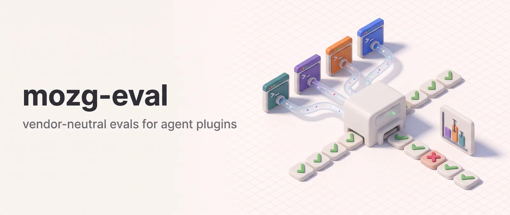
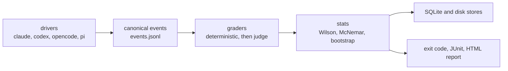

<p align="center"></p>

# mozg-eval

A vendor-neutral eval runner for coding-agent setups. It tests a plugin or a whole harness (instructions, skills, subagents, hooks and MCP servers). One case file runs on Claude Code, Codex CLI, OpenCode and Pi and answers three questions: does the right skill fire (and stay silent on near-misses), does the agent do the job once it fires, and is the setup better than the agent without it. The CLI is `mzeval`. Python 3.13, MIT.

```yaml
# tests/action-smoke/memory-note-fire/case.mzeval.yaml
schema: mzeval/2
name: memory-note-fire
description: The action self-test replays a recorded Claude run that fires memory-note.
kind: fire
expect:
  skill: memory-note
bundle: [../plugin]
execution:
  prompt: Remember this decision.
  tools: [skill]
  runs: 1
```

```console
$ mzeval run action-smoke --junit junit.xml
PASS memory-note-fire #1: ok, skills: memory-note, $0.0040
routing over 1 trials:
  memory-note: precision 1.00, recall 1.00, F1 1.00; near-miss triggers 0/0, other false triggers 0
  expected \ fired  memory-note
  memory-note       1
spend: $0.0040 over 1 trials
run 01a1db96-2ab5-7012-bee1-c60c421825d3: 1 trials, 1 cases, 100% at or above 100% (95% CI 21%-100%)
```

That output comes from the test suite's fake `claude`, which replays a recorded run, so it cost nothing. A real run starts the agent in an isolated temp HOME.

## Status

Phase A, the local runner, is built: spec and `lint`, the 1.1 importer, the four drivers, deterministic graders, the PydanticAI judge, stats, ablation, harness A/B runs and import, `plan`, the static report, JUnit, the GitHub Action and `--push`.

Not built yet:

- Milestone 09, the parity gate against `claude plugin eval` results, is deferred.
- Milestone 15, cutting the plugin repos over to `mzeval`, has not started.
- Phase B and C, the results server (`serve`, trends UI, ingest, `remote run`), exist only in [docs/PROPOSAL.md](docs/PROPOSAL.md). `--push` has a client and no server to talk to yet.

There is no tagged release yet. The binaries, and a tag to pin the Action to, come with the first `v*` tag.

## Install

```sh
uv tool install git+https://github.com/DoctorMozg/mozg-eval-pipelines
mzeval --version
```

From source:

```sh
git clone https://github.com/DoctorMozg/mozg-eval-pipelines && cd mozg-eval-pipelines
uv sync --frozen
uv run --frozen mzeval --help
```

The release workflow builds offline single-file binaries with PyApp (Python and locked dependencies embedded, nothing installed at run time), attached to each tagged GitHub release. Targets:

- Linux x86_64, glibc 2.35 or newer.
- macOS arm64 and x86_64, unsigned. Run `xattr -d com.apple.quarantine <binary>` after download.
- Windows x86_64.

## Quick start

1. Write a `case.mzeval.yaml` next to the plugin it tests, or next to the harness (see [Harnesses](#harnesses)). `mzeval lint examples/cases` validates a tree and prints `9 of 9 case files valid`.
2. `mzeval plan <paths>` validates the cases and estimates cost from stored runs, with no agent started. A case with no stored run says so instead of guessing.
3. `mzeval run <paths> --driver claude` runs them and exits non-zero below the threshold.
4. `mzeval report` writes `report.html` for the latest stored run, with the trend across stored runs.

`<paths>` are case files or directories searched for `case.mzeval.yaml`.

## Case format

A case is strict YAML: an unknown key fails the load with the file and line, and so does a `bundle` directory or `fixture` file that doesn't exist next to the case. `kind` is one of `fire | near-miss | gate | behaviour | trap`. A near-miss asserts the opposite of a fire. From [examples/cases](examples/cases), which run against the small plugin in [examples/plugins/changelog](examples/plugins/changelog):

```yaml
schema: mzeval/2
name: changelog-near-miss
description: Asking whether a version can ship belongs to release-check, even though it mentions the changelog.
kind: near-miss
tags: [routing, negative]
expect:
  skill: { not: changelog-entry, owner: release-check }
bundle: [../../plugins/changelog]
execution:
  prompt: Can I tag 1.4.0 today, or is the changelog still missing something?
  tools: [skill]
  max_turns: 8
  timeout_s: 240
graders:
  - name: gives-a-verdict
    type: judge
    checklist:
      - Says whether 1.4.0 is ready to tag, or names what is missing before it is
drivers: { exclude: [pi] }
```

- `expect.skill` is graded as labelled routing data. It feeds per-skill precision, recall and the confusion matrix.
- `bundle` lists the plugin directories loaded for the case. `tools` are canonical kinds (`skill`, `subagent`, `read`, `write`, `edit`, `glob`, `grep`, `shell`, `ask_user`) and are the only tools the session gets. Leave `tools` out for the agent's default set, or write `tools: []` for none.
- Counts are `min`/`max` (default `min: 1`). `arm: both | with` decides whether a grader counts in the without-bundle arm of an ablation. `weight`, `runs` (default 3), `max_turns` (10) and `timeout_s` (300) carry over from `claude plugin eval` 1.1.
- `fixture` runs a script that prepares the workspace. `drivers: { only: [...], exclude: [...] }` limits where a case runs.
- A grader a driver can't evaluate grades `n/a`, never a vacuous pass.

`mzeval schema` prints the JSON Schema for editors. The full spec is [PROPOSAL §4.4](docs/PROPOSAL.md#44-case-format-v2-a-strict-superset-of-claude-plugin-eval-11).

## Drivers

Each trial runs in a temp HOME so your own skills, hooks and settings don't leak in. Claude trials also leave out your claude.ai connectors. A harness is written into that temp HOME, so it is the only setup the agent sees.

| Agent       | `--driver` | How it runs                                                                     | Auth from the environment                                               |
| ----------- | ---------- | ------------------------------------------------------------------------------- | ----------------------------------------------------------------------- |
| Claude Code | `claude`   | `claude -p` stream-json, with native skills, subagents and hooks                | `ANTHROPIC_API_KEY` or `CLAUDE_CODE_OAUTH_TOKEN`                        |
| Codex CLI   | `codex`    | `codex exec --json` with the plugin installed into a temp `CODEX_HOME`          | `CODEX_API_KEY`                                                         |
| OpenCode    | `opencode` | `opencode run --standalone --format json`, native skills, no subagents or hooks | provider keys such as `ANTHROPIC_API_KEY` (a saved login isn't visible) |
| Pi          | `pi`       | `pi --mode json --no-session`, inferred skills, no subagents or hooks           | provider keys such as `ANTHROPIC_API_KEY` (a saved login isn't visible) |

When both `ANTHROPIC_API_KEY` and `CLAUDE_CODE_OAUTH_TOKEN` are set, Claude uses the API key. Codex skill activation is inferred from reads of `SKILL.md`. `--executable` points a driver at a specific binary.

## Harnesses

A harness is a folder holding the setup an agent runs with. Use one to test whether your rules, skills or hooks change what the agent does, not only whether a single plugin does. [examples/harnesses/my-rules](examples/harnesses/my-rules) is an example: one developer's 19 Claude Code rules as `instructions/`. The layout:

```text
my-harness/
  harness.mzeval.yaml
  instructions/        flat .md files
  skills/<name>/SKILL.md
  agents/<name>.md     frontmatter: name, description
  hooks.json           {"hooks": {"<Event>": [...]}}, Claude settings shape
  scripts/             reached from hooks as ${HARNESS_ROOT}/scripts/...
  native/<claude|codex|opencode|pi>/   copied as is into that agent's config dir
  README.md            optional
```

```yaml
schema: mzeval-harness/1
name: my-harness
description: Team rules plus the docs MCP server.
plugins: [../plugins/changelog]      # dirs relative to the harness
mcp:
  docs: { command: npx, args: [-y, docs-mcp], env: { DOCS_TOKEN: "${DOCS_TOKEN}" } }
  wiki: { url: "https://wiki.example.com/mcp", headers: { Authorization: "Bearer ${WIKI_TOKEN}" } }
```

An `mcp` entry is `{command, args, env}` (stdio) or `{url, headers}` (HTTP). `${VAR}` in `env` and `headers` is filled from the environment when a trial starts. An unset variable stops the run with an error naming it, so harness files never hold secrets. In `native/`, the agent's settings.json, config.toml, opencode.json or mcp.json is merged with what mzeval writes, not replaced. Dotfiles are ignored. `mzeval lint` validates harness folders as well as cases, and `mzeval schema --harness` prints the manifest schema.

### A/B runs

```sh
mzeval plan evals/ --harness none --harness examples/harnesses/my-rules   # trial count x2
mzeval run evals/ --harness none --harness examples/harnesses/my-rules
mzeval compare <run-id> --harness none --harness my-rules
```

[examples/cases/my-rules](examples/cases/my-rules) holds six cases built from those rules, such as short commit messages and secrets kept out of replies.

`--harness` is repeatable and takes a directory, or `none` for the agent's own setup. Every case runs once per harness. The first harness is the baseline, and each other harness is compared against it case by case (score delta, bootstrap CI, McNemar). The baseline doesn't count toward `--threshold` or the exit code, like the without arm of `--ablation`.

- Trial lines are tagged `[harness-name]`. Stats, JUnit and the HTML report group rows as `case @harness`.
- Each trial stores `harness` (the name) and `harness_digest` (a hash of the harness files and its plugins).
- The harness's `plugins` load in both ablation arms. `--ablation` stays a separate axis.
- `compare RUN` on a multi-harness run exits 2 and lists its harnesses. Pick two with `--harness`.

### What each driver does with a harness

| Part         | Claude Code                                    | Codex CLI (0.169)                                             | OpenCode 2 (2.3.0)                                      | Pi (1.5.2)                                 |
| ------------ | ---------------------------------------------- | ------------------------------------------------------------- | ------------------------------------------------------- | ------------------------------------------ |
| instructions | `~/.claude/rules/<file>`                       | `$CODEX_HOME/AGENTS.md`, concatenated                         | `~/.config/opencode/AGENTS.md`                          | agent dir `AGENTS.md`                      |
| skills       | `~/.claude/skills/`                            | `$HOME/.agents/skills`                                        | `skills/`                                               | agent dir `skills/`, passed with `--skill` |
| agents       | `~/.claude/agents/`                            | `$CODEX_HOME/agents/<name>.toml`                              | `agents/<name>.md`, `mode: subagent`                    | not supported                              |
| hooks        | merged into settings.json                      | `$CODEX_HOME/hooks.json`, run through mzeval's capture script | not supported, use `native/opencode/plugins/`           | not supported                              |
| MCP          | `.claude.json` `mcpServers`, workspace trusted | `config.toml` `mcp_servers`, workspace trusted                | `opencode.json` `mcp.servers`, HTTP gets `oauth: false` | `mcp.json` plus `-e builtin:mcp`           |
| load check   | yes                                            | no                                                            | no                                                      | no                                         |

- **Load check.** On Claude Code the session's `init` line must list every skill and agent and show every MCP server `connected`. Otherwise the trial ends in error: `harness <name> didn't load: skill x, MCP server y (failed)`. The other three agents don't report what they loaded (`codex exec --json` doesn't, for one), so a harness there is written but not confirmed.
- **Instruction scoping.** `paths:` frontmatter keeps working only on Claude Code. The other drivers load every instruction always and log a warning.
- **OpenCode** needs OpenCode 2. The case's tool permissions are appended after the harness's, so they win. OpenCode 2 hooks are TypeScript plugins, hence `native/opencode/plugins/`.
- **Pi** runs with `-ne`, so `native/pi/extensions/*` load with `-e`. A harness with agents or hooks can't run on Pi.

If a driver can't load one of the harness's parts, the run stops before any trial with exit 2: `<driver> can't load harness <name>: <parts>`.

### Import from Claude Code

```sh
mzeval harness import claude my-harness --name my-rules --part instructions --part skills
```

`mzeval harness import claude DEST [--name N] [--source DIR] [--part instructions|skills|agents|hooks ...]` reads `--source` (your Claude config dir by default) and copies:

- `CLAUDE.md` and `rules/**/*.md`. Nested rules are flattened to `a-b.md`.
- Skills (folders with a SKILL.md) and agents (with `name` and `description`).
- The `hooks` of settings.json. Scripts they call from inside the config dir go to `scripts/` and the command is rewritten to `${HARNESS_ROOT}`.

It never copies logins, history, `projects/`, `.claude.json`, or settings other than hooks, because `env` there often holds tokens. Add MCP servers and plugins to the manifest by hand. `DEST` must be new or empty, and the result is validated by loading it.

## Graders and the judge

Deterministic graders run first: `skill`, `subagent`, `tool_called`, `tool_order`, `file_changed`, `file_exists`, `regex`, `raw_regex`, `hook_fired` and `command` (a script that runs in the workspace and passes on exit 0). The `judge` grader is for what those can't decide: a checklist with one `pass | fail | unknown` verdict per item. An `unknown` grades `n/a`.

The judge is a PydanticAI agent. Name a model per grader (`model:`) or for the run:

```sh
export ANTHROPIC_API_KEY=...   # OPENAI_API_KEY and OPENROUTER_API_KEY work the same way
mzeval run evals/ --judge anthropic:claude-sonnet-5-5
```

Keys come from the environment, and a missing key stops the run before any agent starts. Judge evidence must be a real quote from the transcript, or the verdict is retried and ends as `unknown`. Verdicts are cached in `.mzeval/judge-cache`. `mzeval rejudge RUN PATHS` regrades a stored run from its stored events with no agent cost. A judge that reads files grades `n/a` there, because the workspace is gone.

## Commands

| Command                                                   | What it does                                                                       |
| --------------------------------------------------------- | ---------------------------------------------------------------------------------- |
| `lint PATHS`                                              | validate case files and harness folders, exit 1 if any is invalid                  |
| `plan PATHS [--driver] [--runs] [--ablation] [--harness]` | validate and estimate cost from stored runs, no agent starts                       |
| `run PATHS [--harness]`                                   | run and grade on one agent, once per harness                                       |
| `rejudge RUN PATHS [--judge]`                             | regrade a stored run's judge graders                                               |
| `compare RUN [BASELINE] [--harness A --harness B]`        | paired scores per case: a run's two arms or harnesses, or a run against a baseline |
| `report [--run ID] [--out FILE]`                          | static HTML report of a stored run plus the trend                                  |
| `push RUN`                                                | upload a stored run to `$MZEVAL_SERVER`, safe to resend                            |
| `schema [--harness]`                                      | print the case JSON Schema, or the harness manifest's                              |
| `harness import claude DEST`                              | make a harness from your Claude Code config                                        |
| `import claude-plugin-eval ROOTS`                         | convert `claude plugin eval` 1.1 cases                                             |

`run` takes `--runs`, `--model`, `--threshold`, `--driver`, `--executable`, `--judge`, `--ablation`, `--harness`, `--junit` and `--push`, plus:

- `--case GLOB` and `--tag TAG`, both repeatable, run only the matching cases. A selection that matches nothing exits 2 before any agent starts.
- `--jobs N` runs up to N trials side by side, each in its own temp HOME and workspace. They share your login and its rate limit. Output keeps the plan order.
- `--max-cost-usd X` caps agent and judge spend for the run. Once it is reached no trial starts, the run exits 2 and says how many trials it left out. Claude reports a trial's cost only at its end, so on Claude the cap stops new trials rather than cancelling the one running.

## Ablation, compare, plan

`--ablation` runs each case with and without its bundle, the plugin-level counterpart of a harness A/B run. A case with no bundle or no `arm: both` grader skips the without arm. Only the with arm counts toward the threshold.

```sh
mzeval plan cases/ --ablation          # cost estimate, nothing runs
mzeval run cases/ --ablation --runs 5
mzeval compare <run-id>                # with vs without, per case
mzeval compare <run-id> <baseline-id>  # this run against an earlier one
```

Comparisons are paired per case. One run per case gets an exact McNemar test. Several runs get a paired bootstrap over cases, resampling each case's runs too, so a one-case comparison still has an interval. Suite pass rate uses a Wilson 95% interval.

## CI

```yaml
- uses: DoctorMozg/mozg-eval-pipelines@main   # pin a tag once one exists
  with:
    paths: evals
    driver: claude
    threshold: "1.0"
  env:
    ANTHROPIC_API_KEY: ${{ secrets.ANTHROPIC_API_KEY }}
```

Inputs: `paths` (required, one per line), `driver`, `threshold`, `runs`, `model`, `judge`, `ablation`, `executable`, `push`, `junit-file` (default `mzeval-junit.xml`) and `artifact-name`. Outputs: `exit-code` and `junit-file`. The action writes the run output to the job summary, uploads the JUnit file as an artifact and exits with the run's code. The self-test in `.github/workflows/action.yml` replays a recorded run through the fake `claude`, seeds a regression and asserts the action fails.

`run --junit FILE` writes one testcase per case, so a JUnit reporter agrees with the exit code: `<error>` when a run errored or timed out, `<failure>` below the threshold, `<skipped>` with the reason. Exit codes: 0 every case meets the threshold, 1 a case doesn't, 2 a trial errored, the setup failed or the spend cap stopped the run, 130 interrupted.

Use API keys in CI. A `claude setup-token` token in `CLAUDE_CODE_OAUTH_TOKEN` works, but Anthropic's terms point automated use at API keys.

## Storage and push

Everything goes under `./.mzeval/` in the working directory: SQLite at `mzeval.db`, plus `events/` and `artifacts/` on disk. Override per store in `mzeval.toml` or with `MZEVAL_RESULTS`, `MZEVAL_EVENTS` and `MZEVAL_ARTIFACTS` (env wins):

```toml
[storage]
results = "sqlite:///data/mzeval.db"
events = "file:///data/events"
artifacts = "file:///data/artifacts"
```

Only `sqlite:` and `file://` are accepted so far.

`--push` and `mzeval push RUN` upload a stored run to `$MZEVAL_SERVER` with `$MZEVAL_TOKEN`. Every call is a `PUT` keyed by run, trial or artifact, or an events `POST` the server deduplicates by `(trial, seq)`, so a resend is safe. A failed push never changes the exit code, and the stored run keeps everything for a retry. The server side is phase B.

## Pipeline



Graders never see vendor JSON, only canonical events. That is why a stored run can be regraded or re-judged without running the agent again.

## Migrating from `claude plugin eval`

```sh
mzeval import claude-plugin-eval evals/ --out migrated/
mzeval lint migrated/
```

The importer reads 1.1 `case.yaml` files and writes `case.mzeval.yaml` next to them, or under `--out`. The originals stay. It also writes `migration-report.md` (or `--report PATH`) with the rules it applied and any grader that needs a manual look. `--force` overwrites existing v2 files. A key that 1.1 doesn't document, which `claude plugin eval` would ignore without a word, is an error with its file and line: that case isn't written and the command exits 1 after checking every case. A 1.1 `Skill` regex becomes `expect.skill`, and `Write`/`Edit` path checks become `file_changed`.

## Development

```sh
uv sync --frozen
uv run --frozen pre-commit run --all-files   # mdformat, ruff, mypy --strict
uv run --frozen pytest
```

CI (`.github/workflows/ci.yml`) runs the same two commands. Binaries build with `scripts/build-pyapp.sh <target-triple>`.

## License

[MIT](LICENSE)
